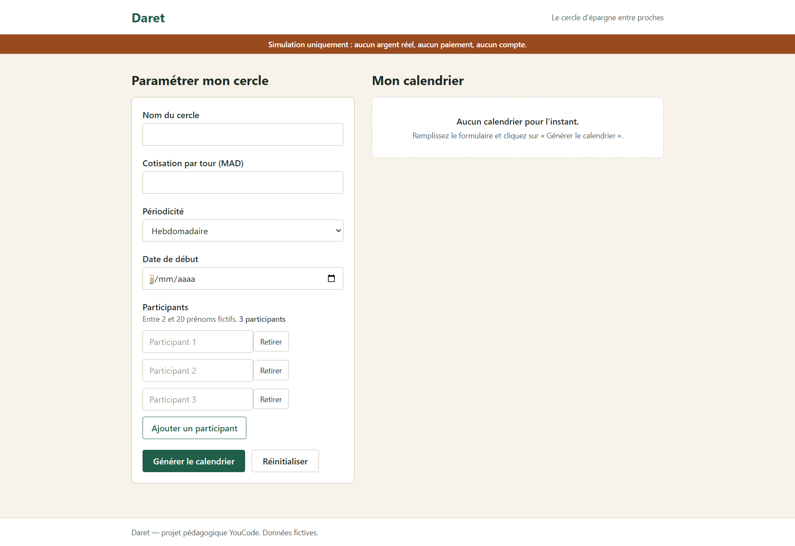
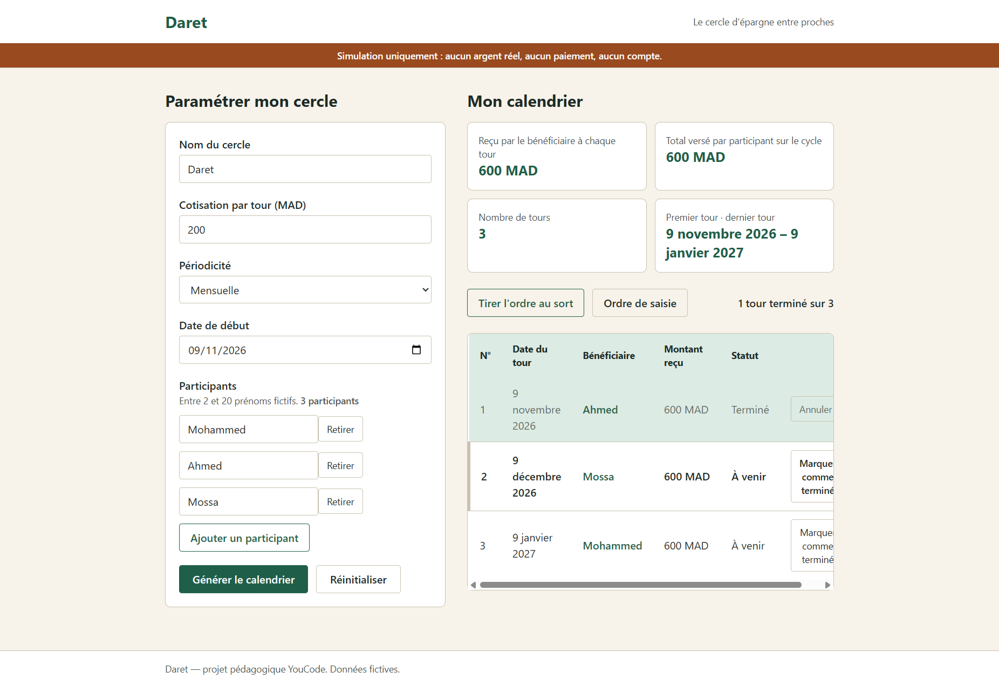
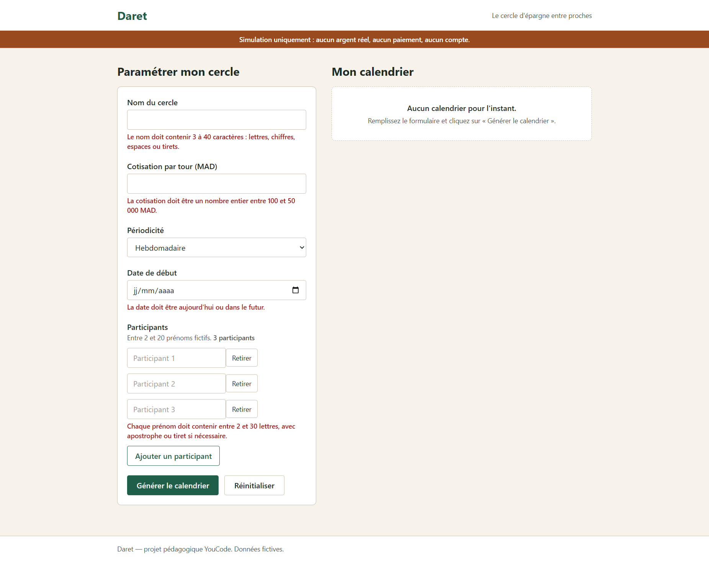
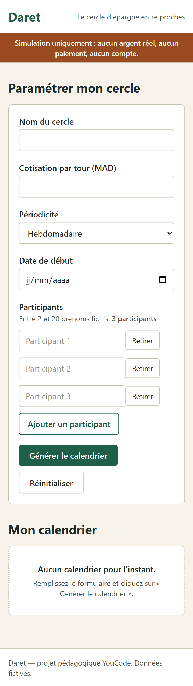
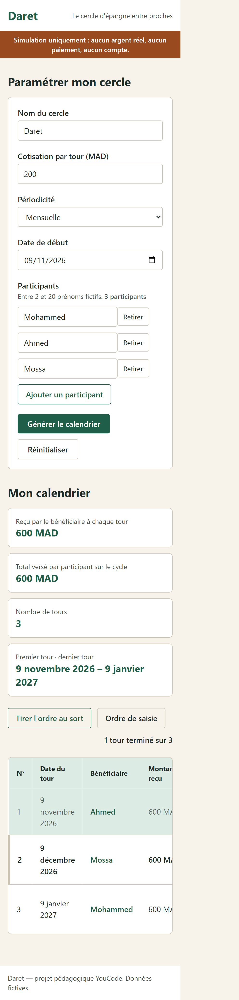

# Daret — Simulateur de cercle d’épargne

## Présentation du projet

**Daret** est une application web pédagogique qui permet de simuler le fonctionnement d’un cercle d’épargne collectif.

L’utilisateur peut créer un cercle, définir le montant des cotisations, choisir une périodicité, ajouter des participants et générer automatiquement un calendrier des tours.

L’application permet également de suivre les tours terminés, de consulter les détails de chaque tour et de visualiser le résumé financier du cercle.

**Important :** ce projet est une simulation pédagogique. Aucun argent réel n’est utilisé, aucun paiement n’est effectué et aucun compte bancaire n’est créé. Les prénoms utilisés doivent être fictifs.

## Liens du projet

- **Site web :** [GitHub Pages](https://najib-taa.github.io/daret/)
- **Tableau GitHub Projects :** [GitHub Projects](https://github.com/users/Najib-Taa/projects/1)
- **Dépôt GitHub :** [Lien GitHub](https://github.com/Najib-Taa/daret)

## Technologies utilisées

- HTML5
- CSS3
- JavaScript
- Tailwind CSS
- Git et GitHub

## Installation

### 1. Installer les dépendances

```bash
npm install
```

### 2. Générer le fichier CSS

```bash
npm run build
```

Cette commande génère le fichier `assets/style.css` à partir de `src/input.css`.

### 3. Lancer le mode développement

```bash
npm run dev
```

Cette commande surveille les modifications du CSS et reconstruit automatiquement le fichier `assets/style.css`.

### 4. Ouvrir le projet

Ouvrir `index.html` dans un navigateur, de préférence avec l’extension **Live Server** de Visual Studio Code.

## Structure du projet

```text
daret-starter/
│
├── assets/
│   └── style.css
│
├── screenshots/
│   ├── desktop-erreurs.png
│   ├── desktop-resultat.png
│   ├── desktop-vide.png
│   ├── mobile-resultat.png
│   └── mobile-vide.png
│
├── src/
│   ├── app.js
│   └── input.css
│
├── .gitignore
├── index.html
├── package.json
└── README.md
```

## Ce qui est fourni et ce qui est à réaliser

| Fichier | Description |
|---|---|
| `index.html` | Structure HTML déjà intégrée avec Tailwind CSS (fourni) |
| `src/input.css` | Design tokens et classes CSS (fourni) |
| `assets/style.css` | Fichier CSS généré automatiquement par Tailwind CSS (fourni) |
| `src/app.js` | Logique JavaScript à développer (à réaliser) |

## Fonctionnalités du simulateur

### US-01 — Validation du formulaire

- Vérifier le nom du cercle : entre 3 et 40 caractères.
- Vérifier la cotisation : nombre entier entre 100 et 50 000 MAD.
- Vérifier la périodicité : hebdomadaire, tous les 15 jours ou mensuelle.
- Vérifier la date de début : aujourd’hui ou une date future.
- Afficher des messages d’erreur précis.
- Utiliser les attributs `aria-invalid` et `aria-describedby`.
- Placer le focus sur le premier champ invalide.

### US-02 — Gestion des participants

- Commencer avec 3 participants.
- Ajouter des participants jusqu’à 20.
- Ne pas autoriser moins de 2 participants.
- Vérifier les prénoms : entre 2 et 30 lettres.
- Empêcher les doublons sans tenir compte des majuscules et minuscules.
- Mettre à jour le compteur des participants.

### US-03 — Calcul du résumé financier

- Calculer le montant reçu par chaque bénéficiaire.
- Calculer le montant total payé par chaque participant pendant le cycle.
- Calculer le nombre total de tours.
- Afficher la première et la dernière date du cycle.

### US-04 — Génération du calendrier

- Générer automatiquement un calendrier des tours.
- Afficher le numéro du tour, la date, le bénéficiaire, le montant et le statut.
- Respecter la périodicité choisie.
- Gérer correctement les dates de fin de mois.
- Afficher les dates au format français.

### US-05 — Tirage au sort

- Mélanger aléatoirement l’ordre des participants.
- Permettre de revenir à l’ordre initial de saisie.

### US-06 — Suivi des tours

- Marquer un tour comme terminé.
- Annuler le statut terminé.
- Mettre à jour le compteur des tours terminés.
- Mettre en évidence le prochain tour à effectuer.

### US-07 — Détails d’un tour

- Ouvrir une fenêtre de détails en cliquant sur le bénéficiaire.
- Afficher le numéro du tour, la date, le bénéficiaire et le montant.
- Afficher la liste des autres contributeurs.
- Fermer la fenêtre avec le bouton, la touche Échap ou un clic à l’extérieur.
- Restaurer le focus après la fermeture.

### US-08 — Réinitialisation

- Réinitialiser le formulaire.
- Supprimer le calendrier généré.
- Effacer le résumé financier.
- Réafficher l’état vide initial.

## Jeu d'essai

Les cas suivants permettent de vérifier le comportement de l’application.

| # | Donnée saisie | Résultat attendu | Résultat obtenu | Validé |
|---|---|---|---|---|
| 1 | Nom : Atlas, cotisation : 500 MAD | Formulaire valide | Formulaire validé | ☑ |
| 2 | Nom : A | Message d’erreur sur le nom | Message d’erreur affiché | ☑ |
| 3 | Cotisation : 50 MAD | Message d’erreur sur le montant | Message d’erreur affiché | ☑ |
| 4 | Cotisation : 50000 MAD | Montant accepté | Montant accepté | ☑ |
| 5 | Date de début passée | Message d’erreur sur la date | Message d’erreur affiché | ☑ |
| 6 | Date de début : aujourd’hui | Date acceptée | Date acceptée | ☑ |
| 7 | Deux participants avec le même prénom | Message d’erreur sur les doublons | Message d’erreur affiché | ☑ |
| 8 | 2 participants | Nombre minimum de participants accepté | 2 participants acceptés | ☑ |
| 9 | 20 participants | Nombre maximum accepté | 20 participants acceptés | ☑ |
| 10 | 21 participants | Ajout du participant refusé | Ajout refusé | ☑ |

## Difficultés rencontrées

| Difficulté | Solution apportée | Issue GitHub |
|---|---|---|
| Comprendre la structure du projet et les fichiers fournis. | Examiner les fichiers et comprendre leur rôle. | Aucune |
| Transformer les éléments HTML en fonctionnalités JavaScript. | Apprendre à manipuler le DOM et utiliser les événements. | Aucune |
| Comprendre la logique des validations et des calculs. | Décomposer le travail en petites étapes et utiliser des fonctions. | Aucune |
| Générer le calendrier et gérer les interactions. | Utiliser JavaScript, les objets `Date` et les événements. | Aucune |

## Captures d'écran

### Version desktop

**Avant de remplir le formulaire**



**Après avoir rempli le formulaire et généré le cercle**



**Lors de l'envoi du formulaire vide (affichage des messages d'erreur)**



### Version mobile

**Avant de remplir le formulaire**



**Après avoir rempli le formulaire et généré le cercle**



## Auteur

Projet réalisé dans le cadre de la formation **YouCode**.

**Nom** : Najib Tnina

**Année** : 2026
